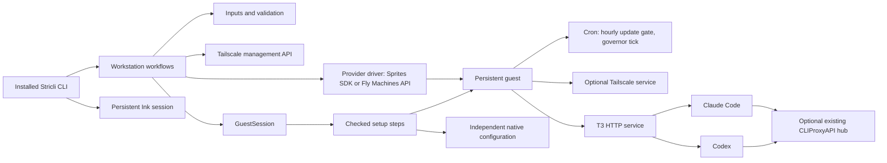

# Workstation architecture

open-agent is a Node 24+ CLI that creates and manages persistent coding workstations on Fly Sprites or Fly Machines through a layered workflow. Root workflows coordinate domain modules, provider drivers and narrow external integrations. The host sets a guest up by sending checked commands over the provider's guest channel, one step at a time; the guest keeps only small POSIX `sh` programs for self-maintenance (boot, service runs, the idle governor, harness hooks, launchers and an hourly updater) beside T3 Code and optional Tailscale. [ARCHITECTURE.md](../../ARCHITECTURE.md) is the shorter maintainer's guide to the same structure. Claude and Codex keep separate native configuration and plugin identities.

## File structure

The tree includes every root source module and the principal nested boundaries; nested leaf listings are selective.

```text
bin
  cli.mjs                     # Installed executable; imports the compiled CLI entry
guest                         # Every guest `sh` program, at the path it installs to under /opt/open-agent; shipped as it is
  governor                    # awake.sh: the idle governor, the awake command and the governed providers' tick
  maintenance                 # update-gate.sh (hourly gate) and updater.sh (upgrades each recorded tool, records update-status.json)
  services                    # cron.sh; runit/lib.sh
  accounts                    # home-files.sh: writes into an account's home as that account
  os/debian                   # lib.sh (packages, repositories, accounts, replay) and update-system.sh
  tools                       # links.sh, and homebrew, npm and rustup lib.sh helpers for each manager
  drivers                     # Launchers, awake adapters and, on Fly Machines, boot.sh and init.sh, by <kind>/<id>
src
  kernel                      # Layer 0: leaf helpers with no product knowledge; Node built-ins and npm packages only
    commands.ts               # The command names
    faults.ts                 # Typed command faults, error codes, recovery state and safe causes
    provider-fault.ts         # ProviderFault, a provider-reported failure
    navigation.ts             # Typed back/cancel navigation exits
    operation.ts              # Invocation lifetime, cancellation, identity and tracing
    status.ts                 # Status updates and the status sink
    diagnostics.ts            # Sanitizing of guest diagnostics
    guards.ts                 # Type guards
    pairing-secret.ts         # The pairing secret, disclosed only on an explicit mint
    records.ts                # Record builders
    redaction.ts              # The registry that redacts resolved secrets at every output boundary
    secret.ts                 # Secret, accepted only as step input
    version.ts                # The running open-agent version
  domain                      # Layer 1: closed ids, declaration and capability data, pure rules and observation shapes; imports kernel
    ids.ts                    # The closed provider, harness, agent and network id tuples and unions
    declarations.ts           # Provider, harness, agent and network declarations and capability data
    profile.ts                # WorkstationProfile, its options and defaults
    profile/options.ts        # Option bounds and driver capability validation
    profile/provider.ts       # Provider capability and machine-size validation
    profile/selection.ts      # Driver ids, harnesses and release-channel validation
    selection-inputs.ts       # The inputs each selection declares
    release-channels.ts       # The agent's release channels
    machine-sizes.ts          # pickMachine, the smallest offer meeting the minimums
    prerequisites.ts          # The checker over declared probes, and the input-problem wording
    tools.ts                  # ToolSpec, its sources and the version probe
    guest.ts                  # OS image, release, family, service backend and guest asset data
    guest-command.ts          # GuestAccount and GuestCommand
    services.ts               # Service definitions and the derived service names
    environment-names.ts      # Names of the credentials and harness environment variables the declarations hold
    creation.ts               # Creation outcome and the fault that carries a retained resource
    findings.ts               # Readiness findings
    readiness.ts              # Readiness status and finding shapes
    recorded.ts               # The recorded profile and its summary
    workstation.ts            # Workstation record, metadata and setup state
    credentials.ts            # Credential source and save-option shapes
    git.ts                    # The Git identity
    harnesses.ts              # Harness labels and id helpers
    networks.ts               # Network id helpers
    observations              # Data shapes of what a probe sees: agent, boot, environment, governor, harness, hub, inspection, native, network and updates
  application                 # Layer 2: workflows and policy; imports kernel, domain and itself
    ports                     # Layer 2a: contracts adapters implement: drivers, guest channel, session, plan, OS family, guest mechanics, host, interaction and ApplicationDependencies
    catalog                   # Lookups over the injected registry: harnesses, networks, services, providers, preflight and the awake hook command
    installation              # Install phases, readiness marking and their progress messages
    inspection                # Inspection progress messages
    result.ts                 # Internal result contracts
    contracts.ts              # Typed command requests and options
    data.ts                   # Concrete result data
    failures.ts               # CommandError and the translation of provider failures to command failures
    navigation.ts             # Safe back/cancel navigation around a prompt
    create.ts                 # Private provisioning workflow
    create                    # Preflight, configuration, create hold, completion and recovery
    input.ts                  # Input-resolution entry point
    input                     # Credentials, source precedence and optional choices
    inspection.ts             # Live list/show and current doctor observations
    machine.ts                # Provider-derived workstation summaries and names
    plugins.ts                # Per-harness plugin selection contract
    readiness.ts              # Observed readiness assessment
    serving.ts                # Wait until the agent answers its environment endpoint
    setup.ts                  # Configuration and incomplete-installation recovery
    setup                     # Section selection, shared configuration and failure recovery
    terminate.ts              # Exact-target deletion and separate tailnet cleanup
    validation.ts             # Determinable input and command conflict checks
    workstation.ts            # Validated internal workflow dispatch
    workstation               # Safe action-menu requests and provider location
  adapters                    # Layer 3: real IO; imports kernel, domain, application/ports and adapters inside the declared sub-matrix
    host                      # The local process, input files, clipboard, credentials, marketplaces, tool lookup and createHostPorts
    guest                     # Host side of the guest
      platform                # Low-level guest operations drivers reuse: layout.ts, assets.ts, accounts, files, run, awake constants, session/ and native/ configuration readers
      os                      # OS families: families.ts and debian/family.ts
      services                # Service backends: backends.ts, cron.ts, provider.ts, runit/ (backend.ts)
      tools                   # The base tool set, the source resolver, Homebrew's account and the helper libraries
      plan                    # Plan assembly, foundation, bottle probing and the tool, file and Homebrew step builders
      environment             # environment.json record, validation and store
      inspection              # Guest probes and their results; they emit facts only
      native                  # Git identity and native inspection
      session                 # connection.ts, the guest session a provider's channel opens
      governor.ts             # The idle governor's services, jobs, hold and report
      release-guard.ts        # Refusal to act on a workstation a newer open-agent set up
      mechanics.ts            # createGuestMechanics, which wires every adapter piece behind the GuestMechanics port
    drivers                   # One entry and folder per driver: src/adapters/drivers/<kind>/<id>.ts and <id>/
      gateways                # Model gateways; cliproxyapi/ owns the hub's inputs, endpoint resolution, URL check and preflight
      agents                  # ACP agents; t3/ owns its tools, service, pairing and readiness
      harnesses               # Claude and Codex configuration, proxy routing, plugins and tools; shared/ holds what both reuse
      networks                # Private networks; none/ is the no-op network, tailscale/ owns preflight, enrolment, daemon, cleanup and its tool
      providers               # Workstation hosts; sprite/ owns the Sprites SDK integration, fly-machine/ the Machines REST API and `fly ssh console` channel
  composition                 # Layer 4: the concrete registry, the defaults and createDependencies(); imports everything except cli
    registry.ts               # The concrete driver registry, checked for completeness at compile time
    defaults.ts               # The selection and options used when nothing else chooses
    dependencies.ts           # createDependencies, built once per invocation
  cli                         # Layer 5: Stricli commands, output and real terminal adapters; imports everything except adapters
    application.ts            # Application metadata and supported help formatting
    commands.ts               # Six command definitions and examples
    execution.ts              # Command-owned mode, cancellation and output lifetime
    emission.ts               # Result emission and recovery wording
    exit.ts                   # Exit-code policy
    flags.ts                  # Command-specific flags and value placeholders
    interaction.ts            # One Ink root and queued prompts
    output.ts                 # Prepared stream output, readable results and TSV
    reporting.ts              # Real stage/status reporting and quiet filtering
    activity.ts               # Persistent-root active-stage state
    serialization.ts          # Versioned, structurally safe final JSON
    components                # All React/Ink views, prompts and presentation bridges
    output                    # The public output shape: each command result is projected explicitly before serialization; details.ts holds human-readable result details
e2e
  setup.ts                    # Builds, packs and installs the package, sweeps leftovers and cleans up the run
  cli.spec.e2e.ts             # Offline: the installed CLI's parsing, output, exit codes and cancellation
  automation-progress.spec.e2e.ts  # Offline: progress output without a terminal
  sprite.spec.e2e.ts          # Real Sprite workstations: the shared suite and the awake task
  fly-machine.spec.e2e.ts     # Real Fly Machines: the shared suite and the provider probe
  machines                    # workstation.ts (the shared suite) and the helpers the machine specs share
  fixtures                    # Network-block helper for offline specs and boot.ts steps for provider probes
spec
  fixtures                    # Real stream and temporary-file helpers; output holds runtime output inputs
  mocks                       # Unit-only official Sprites SDK mock
  kernel                      # Source-mirrored kernel unit specs
  domain                      # Source-mirrored domain unit specs
  application                 # Source-mirrored workflow unit specs
  adapters                    # Source-mirrored host, guest and driver unit specs
  cli                         # Source-mirrored CLI unit specs; components/ holds the real Ink component specs
```

## Main components

- **CLI entry point** (`bin/cli.mjs`, `src/cli/index.ts`, `src/cli/application.ts`): the bin statically imports the compiled entry, which runs the Stricli application and flushes output; the bin reports an unhandled failure generically, then sets the exit status and exits. The package exposes only its executable; internal workflow functions are not a public SDK.
- **Execution boundary** (`src/cli/execution.ts`, `src/kernel/operation.ts`): resolves interaction before effects, owns cancellation and retains observed resource identity for recovery. One invocation-scoped context prevents work from starting after its owner closes.
- **Interactive session** (`src/cli/interaction.ts`, `src/cli/components/InteractionRoot.tsx`): keeps one Ink root mounted across a prompt queue. Rendered components collect input and display state; workflows own cloud mutations.
- **Inputs and validation** (`src/application/input.ts`, `src/application/validation.ts`): apply one source order (flags, credential references, the `--credential-file` dotenv file, the process environment, the saved profile, prompts, defaults), resolve eligible fallback credentials lazily and aggregate determinable preflight issues before provisioning. Each adapter declares the inputs it needs (the provider's credential and tools, the network's keys and account, the gateway's URL and key, the GitHub token and Git identity), and every command that uses one checks it before it mutates anything, naming the absent input and the ways to supply it.
- **Workstation workflows** (`src/application/create.ts`, `src/application/setup.ts`): share ordered native configuration steps, preserve unrelated settings and retain failed resources for recovery.
- **Provider drivers** (`src/adapters/drivers/providers/sprite.ts`, `src/adapters/drivers/providers/fly-machine.ts`): authenticate, paginate live records and check management/organization identity through the Sprites SDK or the Fly Machines API. Each also declares its OS images, service backend, root shell, ready gate and, where it needs one, a boot hook step. Termination revalidates the immutable target identity immediately before deletion.
- **Guest session** (`src/adapters/guest/platform/session/`): the `GuestSession`, a root shell the host drives one framed command at a time.
- **Setup plan** (`src/adapters/guest/plan/`, `src/application/installation.ts`): assembles the typed steps from the provider, the OS family and the tool list, and runs them in a session.
- **OS family and service backends** (`src/adapters/guest/os/`, `src/adapters/guest/services/`, `guest/os/`, `guest/services/`): the shared `lib.sh` of a distribution family, and the runit, cron and provider-run service layers.
- **Tool contract** (`src/domain/tools.ts`, `src/adapters/guest/tools/`): one `ToolSpec` per tool, its sources and the resolver that picks among them.
- **Guest environment** (`src/adapters/guest/environment/`, `src/adapters/guest/release-guard.ts`): the one record setup leaves on the guest and the refusal to manage a workstation a newer open-agent set up.
- **Harness drivers** (`src/adapters/drivers/harnesses/{claude,codex}/`): merge real JSON/TOML and apply independently selected native sources/plugins. Shared reconciliation keeps harness differences explicit.
- **Runtime inspection** (`src/adapters/guest/inspection/`): checks services, routing, native configuration and the T3 environment endpoint without a paid model turn. Each probe is one guest command whose output the host parses. Probe failures become findings rather than disappearing or aborting unrelated observations.
- **Maintenance** (`guest/maintenance/update-gate.sh`, `guest/maintenance/updater.sh`): upgrades the recorded tools in place when due and records the outcome. It never stops, starts, restarts, registers or deletes a service.

## Dependency and execution flow



1. Validate known input/mode conflicts, resolve selected credentials and preflight provider/tailnet facts before provisioning. Preflight resolves each tool against the provider's declared image and refuses when a required tool has no usable source.
2. Provision privately, wait for the guest to be ready (`awaitGuestReady`) and open a `GuestSession`. Its first command reads the guest's OS release, architecture and C library; setup stops when the family differs from the one the provider declared.
3. Run the setup plan: the foundation (guest libraries, the boot hook, accounts, bootstrap packages, Homebrew, the login profile `/etc/profile.d/open-agent.sh` where no boot hook writes it, sysctl settings), one step per tool, the governor's directories and `environment.json`, which stays `incomplete`. Then join the selected tailnet before accessing a private proxy, and merge native settings and plugins.
4. Install the service backend's services and cron jobs, so the agent starts after the configuration it reads at launch. Assess current route, DNS, proxy and the T3 service and its `/.well-known/t3/environment` response.
5. Make T3 public after readiness succeeds and mark `environment.json` ready. Mint a native code last only for an explicit pairing request.
6. Ordinary list/show read the control plane. `list` lists a workstation a newer open-agent set up and marks it (see the downgrade refusal below). `list` covers every registered provider with a credential and reports the rest as unavailable with unknown workstation status, naming the token that would list them; a command without `--provider` asks each ready provider for the workstation (`src/application/workstation/providers.ts`) and refuses only when the name exists on several. `--provider` on `setup`, `show`, `doctor` and `terminate` skips that search, and on every command, `list` included, it names the provider a `--provider-token-source` belongs to (`sprite` when omitted). Explicit inspection and doctor execute guest checks and may wake the workstation.

Adapters may depend on the kernel, the domain and application ports, but cannot import application policy, composition or CLI implementations. Guest programs are `.sh` files under `guest/` that the host reads as assets through `src/adapters/guest/platform/assets.ts` and sends to the guest; no host module imports or runs one locally. Every guest path a program needs, such as the guest root and the agent's home, is defined once in `src/adapters/guest/platform/layout.ts`, and `readAsset` assigns it to the program as an `OA_*` variable right after its shebang, since `sh` cannot import it. Components never own cloud effects. The layer matrix is reviewed as an architectural constraint ([ADR-18](decisions/workstation/adr-18-layer-boundaries-and-runtime-output-contracts.md)); the project registers no ESLint boundary rule. Package subpath imports resolve module locations and do not enforce dependency direction.

## Packaging and local execution

Source `imports` resolve `#*` to `src` and `#cli/components/*` to TSX. `publishConfig.imports` resolves `#*` exclusively to compiled `lib` output when pnpm packs the package. Relative and `#*` imports carry no extension; the build's `tsc-esm-fix` adds `.js` in `lib`. Consequently, invoking the checkout bin against compiled files is not supported.

The `local` script (`pnpm run local -- <command>`) builds, packs and installs a temporary tarball, then runs the installed bin with the caller's arguments and removes the directory on exit. The end-to-end suite does the same once per run in `e2e/setup.ts`, into an isolated run home, and drives that installed bin, so tests exercise the package a user installs and never rewrite aliases. The manifest stays private and no release workflow is supplied.

Nothing TypeScript is deployed to the guest. The top-level `guest/` directory ships as it is (the `.npmignore` includes it; `e2e/` is not packed), at the same paths as in the guest root: `guestAsset(path, mode)` names a program by its path under `guest/`, which resolves from the source tree and the installed package alike, and setup installs it at `/opt/open-agent/<path>`, such as `/opt/open-agent/os/debian/lib.sh`, root-owned: 0700 when only root runs it, 0755 when another account runs it (the awake command, the Sprite awake adapter). Root never runs a file the agent account can write, and the agent account has no sudo rule. The `linuxbrew` account is locked and only root, acting as it, writes Homebrew's prefix, so root may run a formula's executables; every root `PATH` still lists the system's directories, `/usr/sbin:/usr/bin:/sbin:/bin`, before `/usr/local`, and root reads JSON with Debian's `/usr/bin/jq`, which is 1.6 on Debian 12 and refuses what a developer's newer jq accepts: a keyword used as a variable name, an `if` without `else`, or a builtin or syntax added after 1.6. Keep root's jq programs to what 1.6 accepts; no jq 1.6 binary can be fetched at test time, so the machine specs' real guests are the proof. Lint uses the shared Presetter defaults for `src` and `spec`; `bin`, `e2e` and `guest` are outside that scope. Guest runtime verification belongs to the machine specs.

## The guest session

Each setup run opens one `GuestSession` (`src/adapters/guest/platform/session/`): a root shell, the OS family's shell (`dash` on Debian), that the provider opens with `openRootShell` once `awaitGuestReady` returns. How a provider becomes root is its own: `fly ssh console` is root, a VM image logs in as a user with `sudo -n`.

- **Framing.** Each command is single-quoted argv. It runs as its account through the family's `oa_as` helper, under `timeout -k` and in its own process group (`setsid`). Both streams end with an `@@open-agent-status:<uuid>` marker carrying the exit code. Input is a here-document with a random delimiter (base64 for binary data) or `/dev/null`, and `TMPDIR` is `/dev/shm`. Captured output is bounded and redacted.
- **Exclusion.** The session holds a root-only `flock -w 60` and a managed awake hold keyed by its pid, and records its process group, so the next session ends an orphaned one before it takes the lock, even when the group's leader died and only its members remain.
- **Secrets.** A branded `Secret` is accepted only as step input, piped on standard input. A tool that needs a path gets a 0600 file in a private 0700 directory under `/dev/shm`, removed by a trap; Tailscale's enrollment removes the file as soon as it opens it and reads the key through the open descriptor (`--auth-key=file:/dev/fd/3`, the file opened on descriptor 3 and removed in the same shell), so the key is never at rest once the CLI starts. What a crash leaves there is swept when the next session opens, at every Fly boot, and when the Tailscale service starts, each only while no session holds the session lock. Secrets never touch a disk.
- **Faults.** A command's non-zero exit is a result. A broken shell or framing is a transport fault: the outcome is unknown, and only this is retried.

## The setup plan

Setup is a list of typed `SetupStep`s (id, component, account, needs, check, apply, verify, timeout, critical, retry class), ordered by `needs`. A step whose check passes is skipped. Only transport faults are retried, and a retry reruns the step from its check in a new session. System package steps first repair an interrupted run (`dpkg --configure -a` on Debian) and wait for the package lock. Writes into an account's home run as that account through `home-files.sh`, which refuses links and paths another account controls.

A full setup is long because it installs the whole tool set from bottles and packages: typically about 32 to 40 minutes on a Fly Machine and about 7 minutes on a Sprite, whose image already holds more of it. The plan is assembled from the provider, the OS family and the resolved tools (`src/adapters/guest/plan/assembly.ts`) in this order: the foundation, the tool steps, the governor's directories, `environment.json` and then the record of each tool's installed version, whatever the workflow runs before the services (network enrolment and native configuration), and then the service backend's services and jobs. A critical step that fails leaves `environment.json` `incomplete`, which a later setup repairs; a section repair never clears it. Inspection (harness, agent and network probes, `show`, `doctor`) runs one guest command and parses its output on the host.

## Layers

**Provider.** A driver owns what is specific to its machines: provisioning, the guest channel, capabilities and the awake adapter, `openRootShell`, `awaitGuestReady`, and three declarations.

- `images`: the OS images it can create, each with its OS family, release and architectures. Fly: `debian-12` (`debian:bookworm-slim`), family `debian`, `x86_64`. A Sprite boots one image Fly picks, so its release and architecture come only from the guest probe.
- `serviceBackend`: `provider` (a Sprite runs its services itself) or `runit` (an init-less machine such as a Fly Machine). A provider whose machines boot systemd would add a `systemd` backend.
- `bootHookStep`: an optional guest program for what the provider resets on boot. Fly's restores the volume binds, the accounts, a wiped root filesystem and the links. A provider with a persistent root disk declares none.

**OS family.** A family is shared by every provider that runs it; `debian` covers Debian and Ubuntu through `ID` and `ID_LIKE`, and a distribution whose glibc is older than Homebrew's bottles need is refused. Its `guest/os/debian/lib.sh` is sourced by setup, the updater and the boot hook. It supplies the shell and the session's commands, package install, `--only-upgrade` and version queries, signed repository addition with a pinned key fingerprint, account creation and `oa_as`, the packages Homebrew needs and the cron package, whether Homebrew runs on a release, architecture and C library, best-effort sysctl settings (a provider may forbid them), the replay that reinstalls system packages from a local cache after a root-filesystem wipe, and a `policy-rc.d` that keeps a package from starting a daemon. `update-system.sh` is its fragment of the updater.

**Service backends.** Backends do not depend on the distribution, so they are a layer of their own (`src/adapters/guest/services/`, with `guest/services/`). Each service is a runit service directory under `/etc/sv`, enabled by a link in `/etc/service` and dropping to its account through `chpst`, or a service the provider runs. Periodic jobs go to `/etc/cron.d/open-agent` for both backends, and `cron` itself runs as the service `open-agent-cron` (`/usr/sbin/cron -f`), so no vendor init starts a second one. The jobs are the hourly `update-gate` and, on a `governed` provider, the per-minute `governor-tick`.

**Tool contract.** Every tool, base or contributed by a harness, agent or network driver, is one `ToolSpec`: a name, whether it is required, the tools it needs (an npm tool needs `node`), the executables to link, a version probe and `sources` in preference order. A source is `brew` (a formula, owned by `linuxbrew`), `system` (packages of one family with an optional signed repository and the vendor units to mask, owned by root), `npm` (a package at a dist-tag, installed by the agent with Homebrew's `node`; a package pinned to a dist-tag, such as the agent's release channel, is in place only at the version the tag names now) or `rustup` (a toolchain and components, installed by the agent). A source may be limited to families, distributions, architectures or a C library. A tool's `needs` also makes an optional tool required while the tool that needs it is selected: Tailscale needs `iproute2`, optional on its own, because its launcher and exit-route probe run `ip`, so a guest with no usable `iproute2` source is refused at preflight whenever that network is selected.

The resolver (`src/adapters/guest/tools/resolve.ts`) picks the first source the guest can use. Preflight checks the provider's declared image; on the guest it checks again, and a `brew` formula, or a dependency of it, with no bottle for the guest's architecture falls through to the next source. A required tool with no usable source makes preflight refuse; an optional one is skipped and recorded under `setup.skipped`. Adding a provider reuses a family and every tool. Adding a family adds its layer, and a `system` source on each tool Homebrew cannot provide there.

## State, ownership and recovery

Provider labels identify management/schema and completed versus incomplete setup. Name, immutable ID, organization, creation time and provider URL come from live provider records. No local workstation registry replaces that state.

`/opt/open-agent/environment.json` (root-owned, 0644, schema 1) is the one record setup leaves on the guest. The `sh` programs read it with `jq`; the host reads it back to inspect, update and terminate. It holds the open-agent version and setup time, the setup state (`ready` or `incomplete`) and the optional tools skipped, the OS family, the profile, each resolved tool with its source, owner and the version its manager reports installed (`tools[].version`, absent for a system tool; setup and the updater record it after they install or upgrade), the update due interval in days, the provider facts the governor reads, the launch facts of the agent and its harnesses, the network daemon's, the services and cron jobs, and the retained network device identity, which is cleanup data. A record whose schema this release does not know is a `CONFLICT` and is left unchanged. Separate private ownership records retain native proxy fields for safe restoration. Disablement restores only unchanged manager-owned values, preserving user edits and unrelated settings.

`/opt/open-agent/update-status.json` is the updater's record: when the last run started and finished, each tool's outcome with its versions before and after, and the last success. Setup also writes the open-agent version into the provider's workstation metadata.

**Downgrade refusal.** Every command that acts on an existing workstation refuses one whose recorded open-agent is newer than the running one (`src/adapters/guest/release-guard.ts`). `list` is not an action on a workstation, so it never refuses: it lists every workstation of every provider, marks one a newer open-agent set up (the field `newerRelease` in `--json`, and `Workstation NAME was set up by open-agent X; upgrade open-agent to manage it` in the output) and exits 0, so one such workstation does not hide the others. Ordinary `show` compares the metadata version without waking the guest. Commands that wake the guest anyway (`show --inspect`, `doctor`, `setup`) read `environment.json`. The workstation action menu compares the metadata, and each action it offers checks the guest itself, so every one of them refuses. `terminate` wakes the guest to read it and falls back to the metadata version only when the guest cannot be read. An absent `environment.json`, from a setup that never finished, is not newer.

**Links.** Only the executables of `brew` tools in `environment.json` are linked into `/usr/local/bin`, by `guest/tools/links.sh`, and never one the system already provides in `/usr/sbin`, `/usr/bin`, `/sbin` or `/bin`, such as `git` or `jq`; a link left over from before is removed. `system` tools are already on the path, and agent-owned tools stay in the agent's own path, so root never reaches agent-writable code through a link. `/usr/local/bin` is not bind-mounted, so Homebrew's `perl` and `python3` never shadow Debian's in package maintainer scripts. A link is replaced only when it points elsewhere into the Homebrew prefix. Setup makes the links and the boot hook restores them only where missing.

Full setup can recover an incomplete installation. A targeted section repair does not assert global readiness or silently clear an incomplete label. During create, a final pairing failure after readiness/exposure succeeded preserves the ready workstation; an earlier failure attempts private visibility and reports the actual restoration/label outcome. Setup failures retain their section and incomplete-label outcome. Full setup marks READY only after its requested pairing step succeeds.

Termination captures the exact managed tailnet identity before deletion and reports node cleanup independently. A failed or ambiguous query is never absence proof. Destructive consent belongs to the exact request: navigating from show to terminate clears inherited consent and requires its own target confirmation. `setup` decides Tailscale enrolment from the live daemon (`Self.ID`), never from the recorded device, which is cleanup data only: for a logged-out daemon it mints a fresh key from the management API key and, first, deletes the recorded device if the tailnet still holds it, so the new device keeps the workstation name; if that deletion is refused, setup stops and names the device.

## Fly Machine boot and persistence

A Fly Machine's workstation is one app, one machine and one volume, created from `debian:bookworm-slim` with `persist_rootfs: "always"`, so the root filesystem, apt packages included, survives a restart. A marker on it, `/var/lib/open-agent/rootfs-restored`, detects a wipe (such as a host move); a normal cold boot installs nothing.

- **Init stub.** `guest/drivers/providers/fly-machine/init.sh` is the machine's init. The machine configuration's `files` field writes it to `/usr/local/sbin/open-agent-boot` (mode 0755), and the machine runs it with `/bin/sh`, naming the boot hook on the volume. The stub, which uses only the image's own tools, requires the volume and its guest root to be root's alone, binds the guest root, and runs the hook only while the hook and every directory above it are root's alone. Until then, and after a hook that exited unexpectedly, it reports the boot ready so setup can reach the machine to repair it. The hook replaces itself with `runsvdir`; the stub hands a stop to it as a hangup, so runit stops every service, then waits up to 20 seconds for every `runsv` and its service to exit, kills what remains, flushes the volume and exits; the machine configuration gives a stop 30 seconds before Fly kills the machine. A boot that halts waits ten minutes for someone to read the log, then stops the machine through the guest-local Machines API, and retries that request every ten minutes; it postpones the stop while a setup session holds its lock. A hook that halted with the guest root on the volume leaves the guest open for repair: `setup` reaches it, its boot hook step runs `prepare` again, and a prepare that succeeds marks the boot `resumed`, on which the stub runs the hook again through to `runsvdir`. The stub is written only when a machine is created, so everything else lives in the hook, which setup updates without a restart.
- **Boot hook.** `boot.sh` is kept at `/data/open-agent/drivers/providers/fly-machine/boot.sh` and run as root, by the stub on every boot and by setup to prepare the guest. The volume, mounted at `/data`, holds `open-agent`, `home/agent`, `home/linuxbrew` and `apt`; each is bound over `/opt/open-agent`, `/home/agent`, `/home/linuxbrew` and apt's lists, so every path is the one the installer and Homebrew's bottles expect. The hook recreates the `agent` account and the `linuxbrew` system account (no login shell, locked password, no sudo rule) under the ids their surviving homes on the volume were made under, so no file changes owner after the root filesystem is wiped, refusing ids another account holds and never changing an owner. Setup makes the `agent` account 2000:2000, clear of 1000, the first user an image adds (the `ubuntu` account of the Sprite image), and the `linuxbrew` account 900:900 where the provider keeps none of its own, midway through the system range that packages allocate from (999 down, as `systemd-sysusers` and `useradd --system` do, and 100 up, as `adduser --system` does), so the bootstrap packages leave it free; a new volume's home takes `OA_BOOT_AGENT_IDS` (2000), which `AGENT_IDS` in `src/adapters/guest/plan/foundation.ts` keeps in step. An apt hook records every package installed beyond the image's own; after a wipe, the hook reinstalls them from the cache in `/data/apt` with their repositories, without `apt-get update`, and puts back the services and jobs `environment.json` records. On every run it restores the tools' links, writes `/etc/profile.d/open-agent.sh`, labels the machine and sets `net.ipv4.ping_group_range`. Before the packages are back it uses only the image's tools and tools on the volume, and sources a guest library only once the library is root's alone.
- **Reporting.** Each step's outcome and duration goes to the console, which `fly logs` keeps, and to `/opt/open-agent/boot.log`. A boot writes `/opt/open-agent/boot-status.json` and `/run/open-agent/boot-ready`, which carries the boot's id and `ok`, `halted`, `resumed` or `failed`; the host opens the guest channel only once that file names the current boot, and refuses it only for `failed`, a volume or guest root the stub could not bind. A failed optional step leaves the status `failed` for `doctor` but still hands over; the package reinstall is tried three times, 5 and 15 seconds apart, before it counts as failed. A failed critical step (the volume, the guest root, the libraries or an account) halts the boot, which `doctor` reports as `halted` and `setup` repairs.
- **Tailscale.** The node identity and managed resolver files live in `/opt/open-agent/state/tailscale` (root-only, mode 0700) on the volume, so a cold boot keeps the enrolment. The launcher creates that directory and `/var/run/tailscale` itself and skips any recorded transport rule the new kernel no longer holds.

## Privilege and credentials

Root installation operations use trusted managed paths. Every guest program is installed root-owned and unwritable by other accounts, 0700 for root-only programs and 0755 for those other accounts run. Agent tools and native probes execute through the unprivileged account, and the agent account has no sudo rule. Setup refuses an `agent` or `linuxbrew` account that is in any group but its own and `users`. Recursive ownership/configuration work refuses symlinks instead of following them into unrelated paths. Setup runs one session at a time under its lock, and the hourly update gate takes the same lock without waiting, so an update never runs beside a session.

Sprites, Fly and Tailscale management tokens remain local. Enrollment uses a transient private secret that never touches a disk. Selected GitHub and proxy client credentials intentionally persist in protected native guest configuration. Native GitHub authentication configures separate `agent` and provider-shell `sprite` accounts.

Optional credentials are resolved lazily, so an explicit usable source does not fail because an unused saved store is malformed. Storage outcomes report the actual native or protected-file backend. Original work errors retain bounded redacted causes and independently reported restoration/storage failures.

No Sprites connector feature exists. CLIProxyAPI is an existing optional hub: enabled Claude and Codex routing uses their supported native interfaces; disabled routing leaves native sign-in/configuration. Harness configuration records the selected gateway's model-catalogue endpoint and client key in a root-only `/opt/open-agent/cliproxyapi.json`, removed when routing is off; the hub probe runs as root against that record and reports a missing record as an unreachable gateway. The manager generates no static model menu or additional hub.

## Cancellation and output

The CLI owns one physical-interrupt authority. First interruption requests cooperative cancellation and bounded recovery, and aborts a Sprite request that never answers, so one Ctrl-C ends a hung command with one `CANCELLED` result; a second forces exit 130. Unsupported SDK operations may continue remotely after local cancellation, so results preserve known target identity and do not claim rollback or remote cessation.

Human successes use stdout, human failures/cancellations use stderr, and JSON emits one versioned final stdout object. Progress and verbose diagnostics use stderr. Without an interactive display (a pipe, `--non-interactive`, `--json` or `CI`), each setup step is streamed as it finishes as an `Info: …` status line, a failed one as `Warning: …`, so a long setup is never silent; `--quiet` drops the routine lines and keeps the warnings. Piped `list` writes what its TSV cannot carry (an unavailable provider, a workstation a newer open-agent set up) to stderr, and `--json` carries both in the result; either way `list` exits 0 unless every provider failed. Structural pairing capability permits disclosure only after an explicit mint request; the shared registry redacts other resolved secrets at every output boundary. Piped lists use escaped headerless TSV rather than a terminal table.

## Services, maintenance and activity

T3 exposes port 3773 through the provider URL and is the sole public HTTP service. Administration uses the authenticated guest channel. T3 runs as `agent` through its launcher `guest/drivers/agents/t3/launcher.sh`, which reads its port, harness spawn environment and committer from `environment.json`, and, before it starts T3, stops a native T3 server under its runtime that an earlier stop left running, so the restarted agent never finds the port held by the version it replaced. It depends on `tailscaled` (launcher `guest/drivers/networks/tailscale/launcher.sh`, run as root) only when enabled. `open-agent-cron` runs beside them under the service backend. A Sprite registers these services through its own control; a Fly Machine runs them under runit, which `runsvdir` supervises from boot, and `doctor` reads their status with `sv` outside any session. A service whose definition is unchanged keeps its process when setup registers it again.

**Updates.** Cron starts the root-owned `update-gate.sh` (`guest/maintenance/`) every hour. The gate runs the updater once the due interval `environment.json` records (default 1 day, `--update-due-days`) has passed since the last success, or since setup when none succeeded yet; a baseline it cannot read never holds an update back. It takes the setup session's lock, `/run/open-agent-session/session.lock`, without waiting: while a session holds it, a due update waits for the next hour and the gate appends a note to `/opt/open-agent/update.log`, and a session that opens during an update waits for the lock as it waits for another session. Holding the lock, the gate takes a managed awake hold keyed by its own process, runs `updater.sh` in a shell of its own, and logs to `update.log`. `setup --section tools --update` runs the gate with `--force` from its session, which already holds the lock. There is no check interval: an hourly gate that finds nothing due acquires no hold.

The updater upgrades every tool `environment.json` records through the manager its source names, and never installs a missing one: system packages together through the family's fragment (`apt-get install --only-upgrade`), each Homebrew formula that one refresh finds outdated from its bottle (`brew upgrade` with `HOMEBREW_NO_AUTO_UPDATE` set, a formula whose new version has no bottle keeping its own; a current formula runs no further brew command and counts as skipped), each npm tool to its dist-tag, and each Rust toolchain (`rustup update`), both as the agent. It records each tool's installed version in `environment.json`, restores the tools' links, renews the gate's awake hold between tools and writes `update-status.json`. The success time moves only when every required tool was installed or skipped and the links were restored; failed work remains due. The updater issues no service command, so the agent and network daemon keep their process through an update and run the new version when they next restart, and the family's `policy-rc.d` stops a package from starting or restarting a daemon (ADR-12's no-restart rule stands). `setup` and `create` still register services, and re-registering an unchanged service keeps it running.

**Tools.** Nothing on the install or update path builds from source. The base tools come first from Homebrew bottles at the default prefix `/home/linuxbrew/.linuxbrew`, the only prefix bottles pour at, on the volume on Fly: tailscale, runit, jq, git, wget, iputils, bind, netcat, inetutils, iproute2, node, gh, jj, ripgrep, nano (which the login profile names as every account's `EDITOR` and `VISUAL`), python, uv, pnpm, rustup, HTTPie and agent-browser. apt keeps only what Homebrew cannot provide or needs first: `curl`, `git` (to bootstrap Homebrew), `jq` (which root reads JSON with), `ca-certificates`, `procps`, `file`, `unzip`, `gcc` and `libc6-dev` (so cargo and pip can link), `cron`, and Google Chrome with its libraries from Google's signed apt repository, whose key fingerprint is pinned. `runit` falls back to apt where no bottle exists. The Rust toolchain is `stable`, minimal profile with `clippy` and `rustfmt`, installed in the agent's home by `rustup`. T3 Code, Bun, Claude Code and the harness adapters are npm tools the agent installs with Homebrew's `node`; the agent follows the dist-tag of its recorded release channel. agent-browser finds `google-chrome` on the `PATH`, so it never downloads a browser of its own. There is no open-agent Node on the guest.

Homebrew belongs to the dedicated `linuxbrew` system account, so the agent can run its tools but change nothing under the prefix, and root runs brew only as that account through `oa_as` with a fixed environment (`HOMEBREW_NO_AUTO_UPDATE`, `HOMEBREW_NO_ANALYTICS`, `HOMEBREW_NO_ENV_HINTS`, `HOMEBREW_NO_BOTTLE_SOURCE_FALLBACK`). The first install downloads Homebrew's official installer from a pinned Homebrew/install commit, checks its SHA-256 and runs it non-interactively as `linuxbrew`. The installer leaves Homebrew at its newest tag, so setup then checks out the release `HOMEBREW_RELEASE` in `src/adapters/guest/tools/libraries.ts` names, Homebrew/brew `7.0.9`, once the freshly fetched tag names the pinned commit, and its check and verify require that commit. The updater never runs `brew update`, which would move Homebrew to its newest tag: it refreshes only the formula data, from Homebrew's API, with `HOMEBREW_FORCE_API_AUTO_UPDATE`, and upgrades bottles with the pinned code. The pin advances only with open-agent: a release that names a newer Homebrew checks it out the next time setup runs. Before `brew install` or `brew upgrade`, the formula and each runtime dependency must have a bottle for the guest's architecture; otherwise the tool falls through to its next source, or is skipped when optional, and nothing is built. A tool's links in `/usr/local/bin` point through the formula's `opt` link. The agent's `PATH` lists Homebrew's `bin` and `sbin` before the system's, and a `brew` tool's version probe runs with the same order, so both resolve to Homebrew's tools while root's commands resolve to the system's. Those links point into a tree `linuxbrew` owns, so the installer's own `PATH` leaves `/usr/local/bin` out, and GitHub authentication runs `gh` from its keg as the account it configures, never as root.

There are no compatibility, staging, active-work or pinned-Node-major gates. Updates can interrupt active work. Project dependencies, the guest distribution and Sprites runtime are outside maintenance scope.

**Idle governor.** A single idle governor, `guest/governor/awake.sh`, owns activity; ADR-13's rules stand, in `sh`. Claude and Codex hooks run it as the awake command: `UserPromptSubmit` opens a turn hold, `PreToolUse` is a heartbeat and `Stop` and `SessionEnd` close the hold. The command reads the session from the hook's standard input for at most 1.5 seconds, always exits 0 within eight seconds, and every hook allows ten. Managed setup and update work opens managed holds that root writes, keyed by the process whose run keeps them open; the governor prunes a hold once that process no longer matches a live one. A setup session holds the workstation awake while its shell lives, and create adds a managed `create` hold from the first setup step through the wait for the agent to serve, exposure and the READY update (retried every 15 seconds until recorded, refreshed every 5 minutes, closed when create ends), so an idle timeout shorter than setup cannot suspend the machine mid-create; a hold left by a crashed host lapses at the hold maximum. The deadline is the later of the last heartbeat plus the idle timeout (default 5 minutes) and the latest open hold, with no hold outliving the hold maximum (default 60 minutes). A provider that declares `keepAwakeMode: native-deadline` receives the deadline through its awake adapter, applied as the agent account and never as root; the Sprite adapter sets a Sprite task that expires at the deadline and deletes it when nothing keeps the workstation awake, reaching the Sprite socket with `curl --unix-socket`. A `governed` provider such as Fly Machines receives no deadline: cron runs the governor's `tick` as root every minute, and once the deadline has passed and sleep is permitted the tick enters the provider's idle form through the awake adapter. It checks once more, and calls the adapter, under a governor lock (`run/governor.lock`) that every awake event takes shared, so an event recorded before that check keeps the machine awake and one recorded during the call counts after the resume. Each account records the governor state in its own awake directory, root's in `run/awake-root` and the agent's in the sticky `run/awake`, and root's `report` prints the newer; root reads nothing from the agent's directory but holders. The Fly adapter reads `FLY_APP_NAME`, `FLY_MACHINE_ID` and `FLY_VM_MEMORY_MB` from its own environment or, since runit starts services with an empty one, the nearest ancestor's. It suspends its own machine with `POST /v1/apps/<app>/machines/<machine>/suspend` over the root-only `/.fly/api` socket, and stops the machine through the same socket when a suspend is ruled out or refused. `FLY_VM_MEMORY_MB` above 2 GB rules a suspend out; otherwise the adapter reads the machine's description from the socket, and its configuration rules a suspend out with more than 2 GB of memory, swap or a schedule, while a description it cannot read rules nothing out; when both are refused it returns a failure the governor records for `doctor`, and a suspend that ends without an answer is never followed by a stop, since the machine may already have resumed. That outcome is `unknown`, which the governor records as a result and not as a failure. The tick record keeps the kernel's boot id and uptime beside the wall-clock time: a tick that finds another boot id (a cold boot) or a wall clock that moved further than the uptime (a resume from a suspend) restarts the full idle timeout and drops any idle-form call marked in flight. `maxAwakeDeadlineMinutes` is a provider capability (Sprite 60, otherwise unbounded), and profile validation rejects an idle timeout or hold maximum above it. `show --inspect` and `doctor` report the governor state and whether each harness carries the four awake hooks. Arbitrary tools, shell activity and paths bypassing hooks remain outside that coverage.

`doctor` reads `boot.log` and `boot-status.json` where the provider has a boot hook, `environment.json`, `update-status.json`, the governor's report and the service backend's status.

## Verification boundaries

Unit specs mirror source paths and may replace only provider boundaries: `@fly/sprites`, and the Fly Machines API through `fetch`; the machine specs exercise the guest `sh` programs on real guests; they have no unit specs or shell lint hook. Native file merging, parsers, processes, streams and ordinary Ink components use real implementations. The end-to-end project (`pnpm test:e2e [cli|automation-progress|sprite|fly-machine]`) installs the package once in `e2e/setup.ts` and drives that installed CLI without a terminal, rather than rewriting checkout aliases or simulating a whole workflow. Its machine specs create real, paid workstations named `oa-e2e-<run id>-…` with credentials from `.env.test` (`TEST_*` names, documented in `.env.test.example`) that reach the CLI unprefixed; they fail with the CLI's own preflight message when their token is unset. Each run first removes every `oa-e2e-*` workstation its credentials reach, and ends with a best-effort cleanup that sends every delete once and prints `cleanup successful` or the workstations to check by hand. Each run keeps its flyctl configuration in its own directory under the run home.

Focused coverage is an accepted limitation. Configured 100% thresholds remain unchanged; uncovered OS, network and validated-guard paths are reported separately from passing tests. Paid model turns, billing, soak, outage/concurrency experiments, Windows terminals and screen-reader behavior remain outside the verified scope. Operational run narratives belong in work evidence rather than durable documentation.
